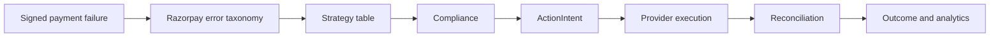
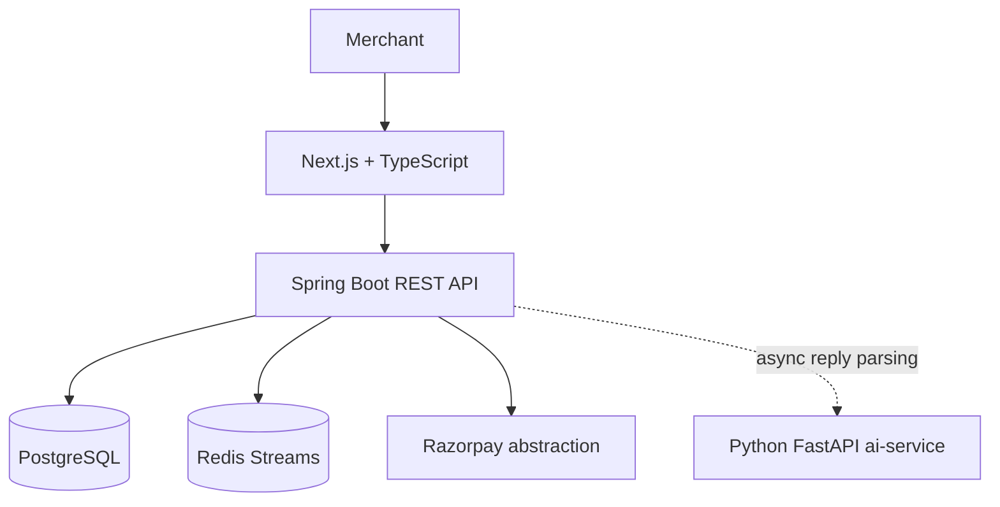

# Mend

Mend is a payment recovery platform that turns signed payment failures into policy-checked, auditable recovery workflows. The payment path is deterministic; AI is used for one asynchronous task: suggesting what a customer's reply means.

## Problem

Recurring payment failures cause revenue loss, but blind retries can be unsafe, ineffective, or non-compliant. Mend classifies each failure from Razorpay's documented error reason and runs it through a deterministic strategy, compliance and execution boundary.

## Solution



Static retry logic applies one fixed rule to every failure. Mend does more:
- it maps each documented Razorpay `error_reason` to a failure class, citing the docs; an undocumented reason is
  `UNCLASSIFIED` and never guessed;
- it picks the strategy per class;
- it adds human review, compliance, idempotent intents, provider reconciliation and merchant-visible evidence.

No model sits on this path ([ADR-003](docs/adr/ADR-003-honest-intelligence.md)).

## Architecture



The provider boundary is specified in [docs/m1/M1-provider-correctness.md](docs/m1/M1-provider-correctness.md) ([ADR-001](docs/adr/ADR-001-payment-provider-boundary.md)); execution safety (claims, dispatch fence, reconciliation) in [docs/m2/M2-execution-safety.md](docs/m2/M2-execution-safety.md) ([ADR-002](docs/adr/ADR-002-execution-safety.md)).

## Customer-reply parsing (the one AI task)

A merchant records a customer's reply on a campaign. A background job sends it to ai-service (`POST /api/v1/parse_reply`,
Gemini, optional key), which returns a *suggestion*: an intent, an optional promised date and an abstain flag.
- The backend validates the suggestion strictly.
- A deterministic policy owns every effect:
  - OPT_OUT stops contact (a compliance block);
  - ALREADY_PAID makes the reconciler check the payment link sooner, and never marks anything paid;
  - DISPUTE opens a review;
  - everything else is shown only.
- Without a key the reply is "model unavailable", and there is no fallback output.
- Evaluation: [docs/m3/eval/RESULTS.md](docs/m3/eval/RESULTS.md).

## Safety

- PostgreSQL is business truth; Redis is transport.
- Webhooks use raw-body HMAC verification and external-event deduplication.
- JWT/RBAC and service-level checks enforce tenant isolation.
- Compliance is evaluated before ActionIntent creation and revalidated before execution.
- ActionIntent carries idempotency, expiry, claim ownership, and execution state.
- Provider evidence, never model output, establishes recovery. No AI output can create, approve, resend or finalize an action.
- High-risk or conflicting cases can require human approval.

## Verified Results

- Backend: 660 tests, 0 failures (`cd backend && ./mvnw test`, each run on its own throwaway database); frontend: 39 tests (`npm test`). The ai-service tests are M3-owned and were not re-run in the pre-M3 cleanup ([docs/audit/cleanup-report.md](docs/audit/cleanup-report.md)).
- `./scripts/verify.sh` passes, including the Next.js production build.
- Reply parsing: keyword baseline evaluated on a SYNTHETIC dataset; model metrics TBD until a run with a key ([docs/m3/eval/RESULTS.md](docs/m3/eval/RESULTS.md)).
- Webhook load measurements are qualified local results: 85.0 events/s full sequential, 101.1 ingestion-only, and 65.2 concurrent under Phase 20 conditions.
- No recovery-uplift percentage, real recovery rate, API p99, or production throughput guarantee is claimed.

## Technology

Next.js, TypeScript, Java 21, Spring Boot, PostgreSQL, Flyway, Redis Streams, Python 3.12, FastAPI (reply parsing only), JWT/RBAC, and Razorpay provider abstraction with mock and TEST MODE paths.

## Demo

The demo covers low-risk retry, high-risk human approval, customer action, provider timeout/reconciliation, duplicate webhook, and an unclassified failure that is never guessed. Every scenario is SIMULATED and labelled as such. `/api/v1/demo` exists only with the `dev` profile (see Profiles below); otherwise the console's demo page shows "Demo disabled". Details: [docs/hygiene/pre-m3-hygiene.md](docs/hygiene/pre-m3-hygiene.md).

## Setup

```bash
cp .env.example .env
docker compose up -d          # PostgreSQL (5433) and Redis (6379) only
./scripts/verify.sh

# Run the backend locally with the dev profile (dev seed data and the SIMULATED /api/v1/demo scenarios):
cd backend && SPRING_PROFILES_ACTIVE=dev ./mvnw spring-boot:run
```

The backend has **no default profile**. Started without `SPRING_PROFILES_ACTIVE` it runs Spring's `default` profile: no dev seed and no `/api/v1/demo` (404). Set `SPRING_PROFILES_ACTIVE=dev` only for local development.

Every environment variable the code reads is listed in [.env.example](.env.example) with its default. Ports: frontend 3000, backend 8080, ai-service 8000, PostgreSQL 5433, Redis 6379. Razorpay TEST MODE needs `MEND_PAYMENT_PROVIDER=razorpay`, the key pair, `RAZORPAY_WEBHOOK_SECRET` and `RAZORPAY_SINGLE_TENANT_MERCHANT_ID`; recorded contracts are under `backend/src/test/resources/razorpay/recorded/`.

### Profiles

| `SPRING_PROFILES_ACTIVE` | dev seed data | `/api/v1/demo` | `JWT_SECRET` | use |
|---|---|---|---|---|
| unset (Spring `default`) | off | 404 | **required** (≥ 32 bytes); the backend fails to start without it | any shared or deployed environment |
| `dev` | on (`MEND_DEMO_DATASET_V1`) | on, SIMULATED scenarios | optional; falls back to a public dev-only secret | local development only |

Tests run with their own `test` profile and a throwaway database per run; they never touch the dev database.

### Analytics

Analytics amounts come only from the strict minor-unit parser (positive integral paise with a supported currency). They are summed exactly; a campaign whose original amount cannot be resolved is counted as `amountUnknownCount` and never given a default amount. "Recovered" means recovered by MEND (`recovery_attribution = MEND`). Late captures of the original payment and RECOVERED campaigns without an attribution (recovered before V15, or by the SYNTHETIC mock provider) are reported separately. Details: Group 4 of [docs/audit/cleanup-report.md](docs/audit/cleanup-report.md).

## CI

`.github/workflows/ci.yml` runs on every push and pull request. Each job only calls a script, so running the scripts
locally reproduces the pipeline:

```bash
docker compose up -d postgres redis   # PostgreSQL on 5433, Redis on 6379
scripts/ci/backend.sh                 # ./mvnw clean test (unit + integration; own throwaway database per run)
scripts/ci/migrations.sh              # fresh empty database: Flyway migrate V1..latest, then validate
scripts/ci/frontend.sh                # npm ci, lint (0 errors), jest, next build
scripts/ci/ai-service.sh              # fresh virtualenv from requirements.txt, pytest
```

In CI the backend and migrations jobs get PostgreSQL and Redis service containers (`MEND_TEST_DB_SERVER_URL`,
`REDIS_HOST`); no repository secrets are needed (the backend job generates a throwaway `JWT_SECRET`). Two security jobs
need no build dependencies: `secret-scan` (gitleaks over the full history, with `.gitleaks.toml` allowlisting only the
literal test placeholders) and `dependency-review` (pull requests only; fails on high-severity advisories; needs the
repository's dependency graph enabled, which is the default for public repositories, and GitHub Advanced Security for
private ones). The first real GitHub run happens when the repository is pushed; until then only the local script runs
are evidence.

## Project Structure

- `frontend/`: merchant console and route tests.
- `backend/`: authoritative API, event processing, compliance, ActionIntent, providers, reconciliation, and audit.
- `ai-service/`: `/health` and `/api/v1/parse_reply` (customer-reply parsing), the evaluation script (`eval/`), and tests.
- `scripts/`: repository verification.
- `docs/`: milestone design docs and evidence (`m1/`, `m2/`), ADRs (`adr/`), hygiene and audit reports (`hygiene/`, `audit/`).


## Limitations

Mend is a regression-green single-host engineering demonstration, not a production-deployment-ready SaaS. Remaining gaps include optional deployment-configured ai-service authentication, no inbound reply channel (replies are recorded by the merchant), no measured model accuracy yet, external secret management, TLS/ingress, rate limiting, monitoring, database HA/backups, and live Razorpay production certification.

## Documentation Index

- Rules for contributors and coding agents: [AGENTS.md](AGENTS.md).
- M1, provider correctness: [docs/m1/M1-summary.md](docs/m1/M1-summary.md), spec [docs/m1/M1-provider-correctness.md](docs/m1/M1-provider-correctness.md), [ADR-001](docs/adr/ADR-001-payment-provider-boundary.md).
- M2, execution safety: [docs/m2/M2-summary.md](docs/m2/M2-summary.md), spec [docs/m2/M2-execution-safety.md](docs/m2/M2-execution-safety.md), [ADR-002](docs/adr/ADR-002-execution-safety.md). The provider lease-expiry duplicate-call boundary is closed there (`M2ExitCriteriaTest.brief19`).
- Pre-M3 hygiene (isolated test database, gated demo): [docs/hygiene/pre-m3-hygiene.md](docs/hygiene/pre-m3-hygiene.md).
- Unused-code audit and the cleanup that followed it: [docs/audit/unused-code-audit.md](docs/audit/unused-code-audit.md), [docs/audit/cleanup-report.md](docs/audit/cleanup-report.md).
- Pre-M1 health check (historical): [docs/health-check.md](docs/health-check.md).
